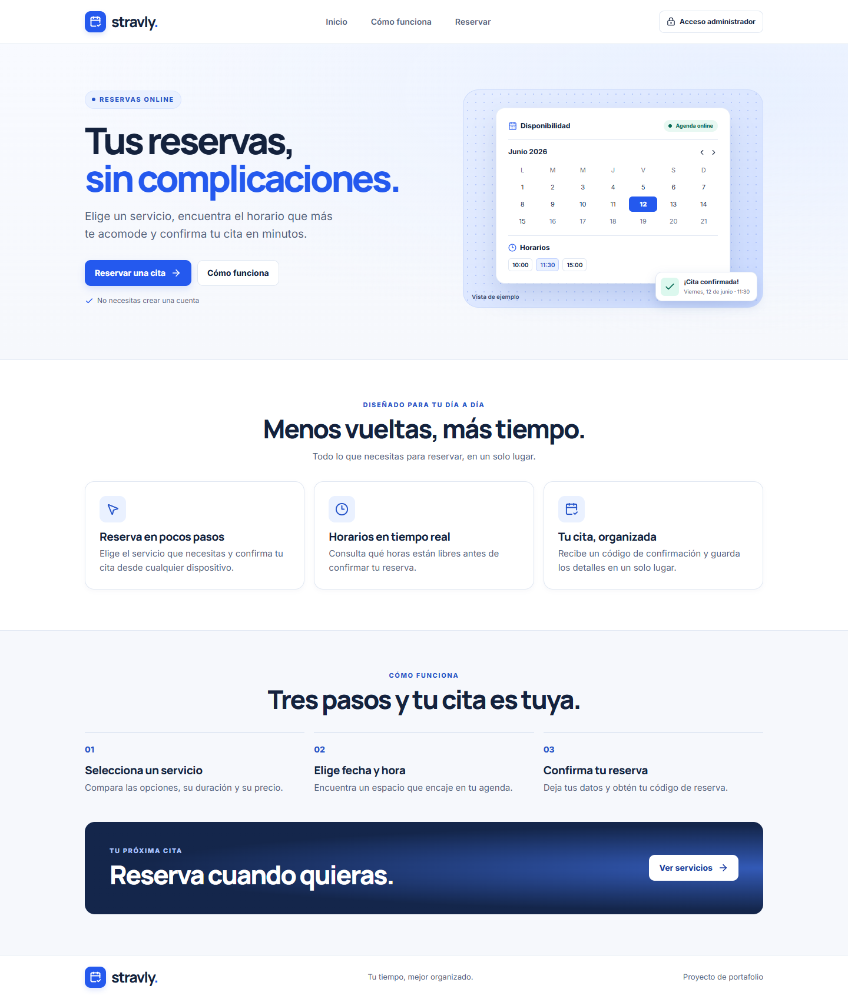
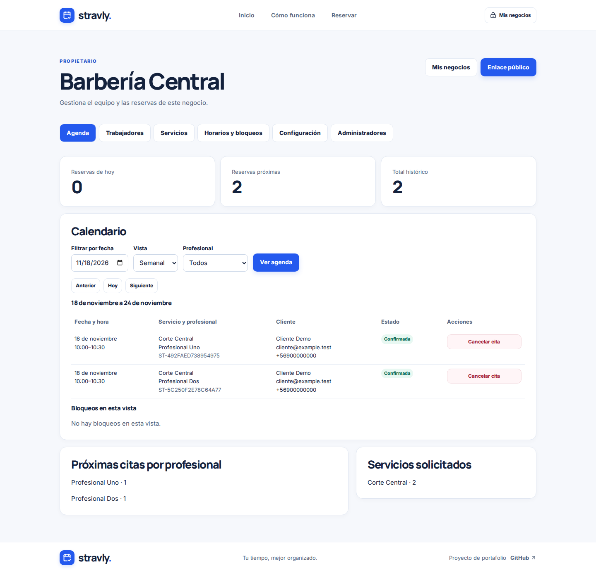

# Stravly

Stravly gestiona reservas para barberías y otros negocios con atención por cita. Cada negocio tiene su propia página pública y cada profesional tiene su propia agenda. Los clientes reservan sin abrir una cuenta.

[Abrir Stravly](https://stravly.vercel.app/)

## Qué puedes hacer

- Un propietario se registra en `/registro`, confirma su correo y crea uno o más negocios. El alta crea los horarios iniciales y la primera agenda.
- El panel permite configurar servicios, añadir profesionales, asignar servicios y horarios, programar bloqueos y ver las citas por día, semana o profesional.
- Cada negocio comparte su enlace `/b/<slug>`. El cliente elige un servicio y un profesional, o acepta cualquiera que esté disponible. La confirmación incluye el nombre del profesional y el código de la cita.
- El propietario puede invitar y retirar administradores. El enlace se comparte de forma privada, caduca en 48 horas y solo lo acepta la cuenta con el correo verificado que se indicó.

La agenda usa la zona horaria `America/Santiago`. Cada servicio consume un intervalo de tiempo completo y las reservas se pueden hacer con hasta 60 días de anticipación. Para probar el proyecto, usa datos ficticios.

## Tecnologías

Next.js App Router, React, TypeScript, Tailwind CSS, Lucide, Supabase Auth y PostgreSQL. Stravly se ejecuta en Vercel. Las pruebas usan Node.js, PGlite, PostgreSQL y Playwright.

## Capturas de la demo de la versión 1



[Portada en móvil](docs/capturas/inicio-movil.png) · [Formulario de reserva con horarios libres](docs/capturas/reserva-escritorio.png) · [Agenda con una cita ficticia](docs/capturas/agenda-escritorio.png)

## Capturas de Stravly 2.0

Estas vistas se capturaron durante la prueba integral con Supabase y datos ficticios.



[Gestión de profesionales y horarios](docs/capturas/multi-trabajadores.png) · [Reserva pública en móvil](docs/capturas/multi-reserva-movil.png)

## Ejecutar en local

Requisitos: Node.js 24, npm y un proyecto Supabase dedicado a Stravly.

```bash
npm ci
```

Copia `.env.example` a `.env.local` (`Copy-Item .env.example .env.local` en PowerShell) y rellena:

| Variable | Valor |
| --- | --- |
| `SUPABASE_URL` | URL del proyecto, disponible en **Connect**. |
| `SUPABASE_PUBLISHABLE_KEY` | Clave `sb_publishable_…` de **Project Settings → API Keys**. |
| `SUPABASE_SECRET_KEY` | Clave `sb_secret_…` del mismo proyecto. Solo servidor. |
| `STRAVLY_GITHUB_URL` | Opcional. Sustituye el enlace al repositorio oficial si alojas una copia pública llamada `stravly`. |
| `STRAVLY_MULTI_BUSINESS` | Activa las rutas 2.0 con `1`. El valor predeterminado `0` mantiene la aplicación original. |
| `STRAVLY_SHOW_DEMO` | Opcional en 2.0. Usa `0` para habilitar la portada sin la agenda de demostración de Estudio Norte. |

La clave secreta da acceso privilegiado al proyecto. Guárdala en `.env.local` o en las variables sensibles de Vercel. Evita el prefijo `NEXT_PUBLIC_` y no subas este archivo.

1. En el **SQL Editor** del proyecto nuevo, ejecuta una vez la [migración inicial](supabase/migrations/20261114000100_stravly.sql). Incluye tres servicios ficticios, horarios y políticas de acceso.
2. En **Authentication → Settings**, desactiva **Allow new users to sign up**. En **Authentication → Users**, crea manualmente una cuenta con correo y contraseña fuerte y confirma el correo desde el panel de Supabase. Copia el UUID de ese usuario.
3. En **SQL Editor**, añade ese UUID a la lista de administradores. La contraseña se gestiona exclusivamente en Supabase:

```sql
insert into public.administrators (user_id)
values ('REEMPLAZA_POR_EL_UUID_DEL_USUARIO'::uuid);
```

4. Ejecuta `npm run dev` y abre `http://localhost:3000`. Prueba `/reservar` e inicia sesión en `/admin/login`.

Los pasos anteriores corresponden a la versión 1 de Estudio Norte. Para activar la versión 2.0 en otro entorno, consulta la [guía multiempresa](docs/multi-business.md).

## Arquitectura

| Capa | Qué hace |
| --- | --- |
| `src/app/` | Portada, formulario público, API de disponibilidad y panel privado. |
| `src/lib/` | Validación, formatos de fecha y precio, clientes Supabase para servidor. |
| `supabase/migrations/` | Tablas, políticas RLS, agenda inicial y funciones de disponibilidad y confirmación. |
| `tests/` | Pruebas de validación, base de datos, concurrencia y navegador. |

El navegador recibe el catálogo y los horarios libres. Al confirmar, la acción de servidor valida los campos y llama a una función SQL reservada a la clave secreta. La función verifica el horario, registra la reserva dentro de la transacción y devuelve el código. La base de datos aplica una restricción de exclusión a los intervalos de citas confirmadas.

El panel usa cookies de sesión de Supabase Auth, comprueba la pertenencia a la lista de administradores y aplica RLS a cada operación. Una cuenta normal no puede consultar las reservas. Los resultados del panel no se almacenan en caché compartida.

En 2.0, las tablas privadas están vinculadas a `business_id`. Las relaciones entre servicios, profesionales y reservas usan claves compuestas para mantenerlos dentro del mismo negocio. Las consultas públicas devuelven el catálogo y los horarios libres. La confirmación vuelve a comprobar la disponibilidad en una transacción y PostgreSQL impide los solapamientos por profesional. Los datos de clientes solo se consultan desde el panel autorizado.

## Pruebas

```bash
npm run lint
npm test
npm run build
npm run typecheck
npx playwright install chromium
npm run test:e2e
```

- `npm test` ejecuta validaciones y aplica la migración en PostgreSQL embebido. Comprueba permisos, reservas, horarios ocupados, cancelaciones, servicios, bloqueos y el límite de intentos.
- `npm run test:e2e` usa la compilación de producción en escritorio y móvil. Una API local de pruebas conecta la app con la base migrada. Cubre la reserva pública y la redirección de usuarios anónimos; el inicio de sesión con Supabase Auth se verifica en un proyecto Supabase.
- `npm run test:concurrency` requiere `STRAVLY_TEST_DATABASE_URL`, apuntando a una base local vacía llamada `stravly_test` en un clúster PostgreSQL descartable, sin roles de Supabase. Usa dos conexiones reales para comprobar reservas simultáneas y cambios de disponibilidad. GitHub Actions provee este clúster en cada ejecución.
- `npm run test:multi` cubre el registro por correo, la agenda de dos negocios y el flujo de invitación con Supabase local y Mailpit. El trabajo de integración de GitHub Actions instala ese entorno y genera capturas cuando la prueba pasa.

## Estado y próximas mejoras

Los profesionales se gestionan como registros del negocio y aún no tienen credenciales propias. La zona inicial para todos los negocios es `America/Santiago`. La confirmación de la reserva se muestra en pantalla.

La demo pública conserva la versión 1 mientras se valida la migración y se prepara el registro para usuarios externos. [Guía de despliegue y verificación de la demo](docs/despliegue.md).
