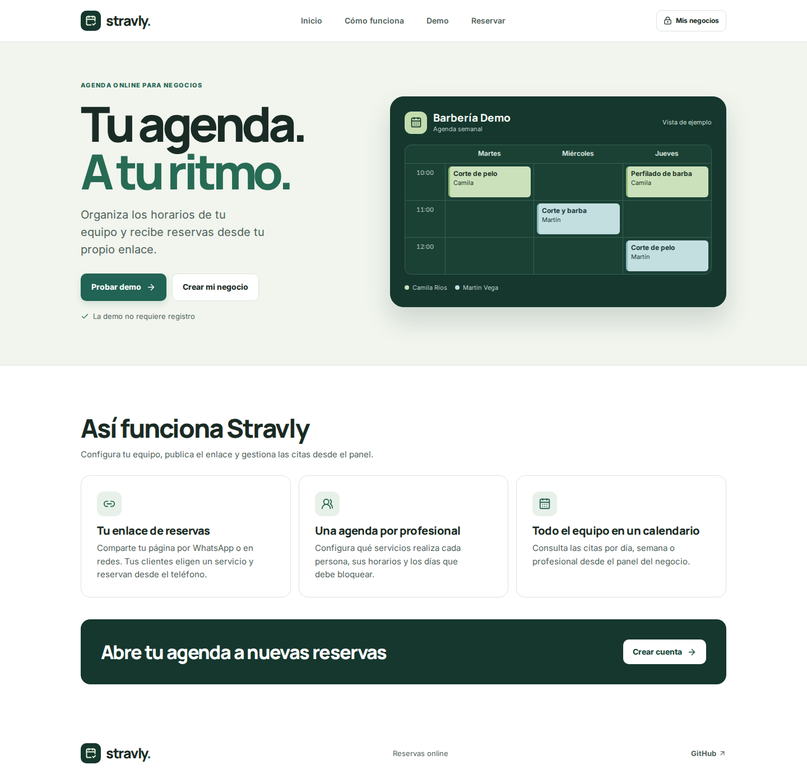
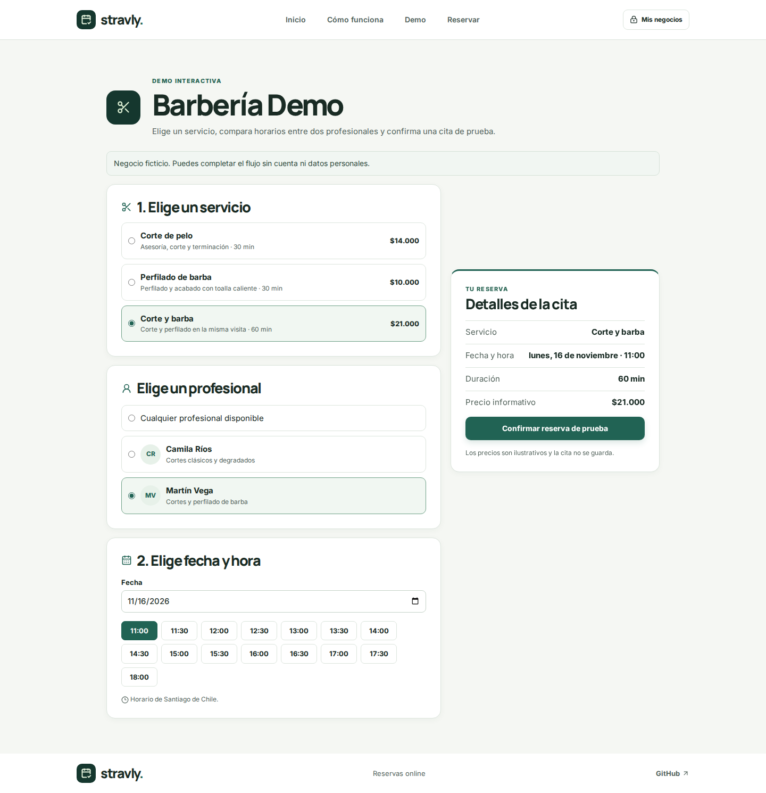
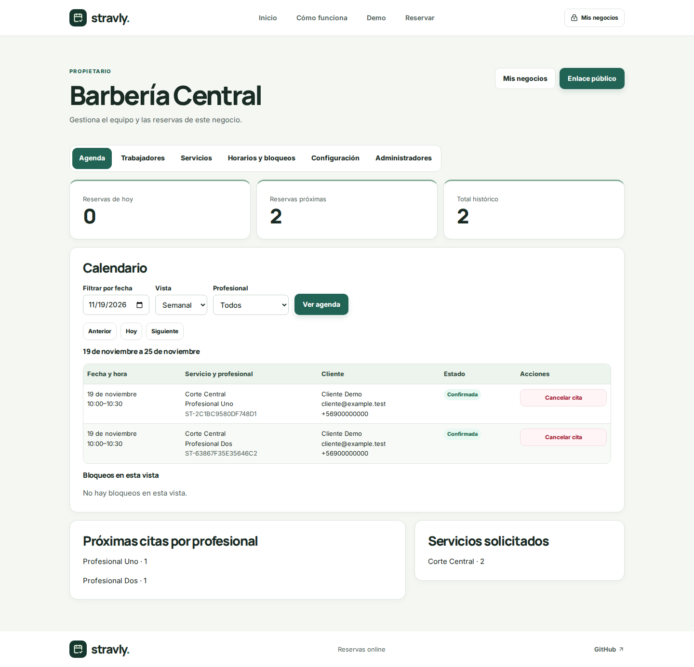
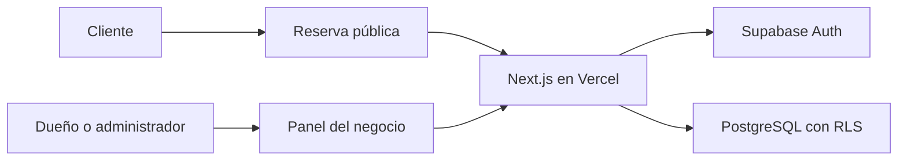

# Stravly

Stravly es una agenda de reservas para barberías y otros negocios que atienden por cita. Centraliza los horarios del equipo y evita gestionar cada reserva por mensajes. Cada negocio comparte su propio enlace, donde los clientes pueden reservar desde el teléfono.

[Probar la demo](https://stravly.vercel.app/demo) · [Abrir Stravly](https://stravly.vercel.app/) · [Repositorio](https://github.com/benjaalbo888/stravly)

La demo **Barbería Demo** incluye tres servicios y dos profesionales ficticios. Selecciona un servicio, un profesional y una hora para recibir un código de prueba. La demo funciona sin cuenta, sin datos de contacto y sin guardar citas.

## Funcionalidades

- Portada pública por negocio en `/b/<slug>`, con catálogo, precios informativos, profesionales y horarios.
- Reservas sin cuenta con selección de profesional o asignación a cualquiera disponible.
- Panel con agenda diaria, semanal y de próximas citas. Permite filtrar por profesional y gestionar servicios, horarios y bloqueos.
- Una cuenta puede gestionar varios negocios. El propietario puede invitar administradores con un enlace de un solo uso.
- Zona horaria `America/Santiago`, con disponibilidades calculadas según la duración de cada servicio.

## Capturas



| Reserva de prueba | Calendario administrativo |
| --- | --- |
|  |  |
| [Reserva en móvil](docs/capturas/portfolio-demo-movil.png) | [Gestión de profesionales](docs/capturas/portfolio-trabajadores.png) |

Las capturas se tomaron en la aplicación con negocios, profesionales y clientes ficticios.

## Tecnologías y arquitectura

| Capa | Implementación |
| --- | --- |
| Interfaz | Next.js App Router, React, TypeScript, Tailwind CSS y Lucide. |
| Servidor | Server Actions y Route Handlers para formularios, sesiones y disponibilidad. |
| Datos y autenticación | Supabase Auth, PostgreSQL, políticas RLS, funciones SQL y restricciones de integridad. |
| Despliegue y pruebas | Vercel, GitHub Actions, Node.js, PGlite, PostgreSQL y Playwright. |



El visitante consulta el catálogo y las horas libres. Al enviar el formulario, el servidor valida los datos y PostgreSQL vuelve a comprobar horarios, asignaciones y bloqueos dentro de una transacción. Una restricción de exclusión impide solapamientos en la agenda de un mismo profesional. La respuesta devuelve un código de confirmación.

Los dueños se registran con correo y contraseña. Supabase Auth envía un código de confirmación, y Next.js mantiene la sesión con cookies HTTP-only. Crear un negocio asigna al usuario verificado el rol de propietario. El panel comprueba la sesión y las políticas de la base de datos restringen los accesos por membresía y negocio.

## Ejecutar en local

Necesitas Node.js 24 y npm.

```bash
npm ci
npm run dev
```

Abre `http://localhost:3000/demo` para probar el simulador sin configurar Supabase.

### Configurar Supabase para reservas reales y administración

1. Usa un proyecto Supabase dedicado al entorno. En el SQL Editor de una base nueva, aplica en orden [la migración inicial](supabase/migrations/20261114000100_stravly.sql) y [el modelo multiempresa](supabase/migrations/20261115000100_multi_business.sql).
2. En Supabase Auth habilita el registro y la confirmación por correo. Usa la [plantilla de código](tests/supabase/confirmation.html) y configura SMTP para enviar confirmaciones a usuarios externos. En las pruebas locales, GitHub Actions usa Mailpit.
3. Copia `.env.example` a `.env.local` y configura las variables de la tabla. Reinicia el servidor, abre `/registro`, confirma tu correo y crea un negocio.
4. Si administras una instalación anterior, sigue la [guía de migración y recuperación](docs/multi-business.md). La importación de Estudio Norte es opcional y se ejecuta por separado.

| Variable | Uso |
| --- | --- |
| `SUPABASE_URL` | URL del proyecto para Auth y la API de datos. |
| `SUPABASE_PUBLISHABLE_KEY` | Clave publicable de Supabase. Disponible en **Project Settings → API Keys**. |
| `SUPABASE_SECRET_KEY` | Clave privilegiada de Supabase. Solo en el entorno del servidor. |
| `STRAVLY_MULTI_BUSINESS` | Usa `1` para las rutas de registro y panel multiempresa. |
| `STRAVLY_SHOW_DEMO` | Usa `0` para que el enlace antiguo `/reservar` oriente al visitante a la página de su negocio. El simulador `/demo` es independiente. |
| `STRAVLY_GITHUB_URL` | Opcional. Permite enlazar a otro repositorio público llamado `stravly`. |

## Decisiones técnicas y seguridad

- Las tablas privadas se filtran mediante RLS por `business_id` y membresía. Las claves foráneas compuestas impiden combinar servicios, profesionales y citas de negocios diferentes.
- Las funciones públicas devuelven el catálogo, los datos de contacto publicados por el negocio y la disponibilidad. El acceso a datos de clientes requiere pertenecer al negocio.
- Los enlaces de invitación caducan en 48 horas, solo sirven una vez y requieren verificar el correo del destinatario. La base conserva el hash del token.
- La confirmación de reservas reales pasa por el servidor. Hay un límite de intentos por cliente y hora. Guarda la clave secreta en `.env.local` o en las variables protegidas de Vercel.
- La demo comparte el formulario con la aplicación. Las horas de ejemplo se verifican en el servidor y su confirmación funciona sin base de datos.

## Pruebas

| Comando | Cobertura |
| --- | --- |
| `npm run lint`, `npm run typecheck`, `npm run build` | Estilo, tipos y compilación de producción. Ejecuta el build antes de verificar tipos en una instalación limpia para generar los tipos de Next.js. |
| `npm test` | Validación, zona horaria, permisos RLS, disponibilidad, migración e invitaciones. |
| `npm run test:concurrency` | Reservas concurrentes con dos conexiones a una base PostgreSQL local descartable. |
| `npm run test:e2e` | Navegación, reservas originales y protección del panel en escritorio y móvil. |
| `npm run test:multi` | Registro con Supabase y Mailpit locales, creación de negocios, aislamiento, reservas e interfaz de la demo. |

El [workflow de GitHub Actions](.github/workflows/verify.yml) prepara las bases aisladas y ejecuta la suite completa.

## Estado y posibles mejoras

Stravly está publicado como proyecto de portafolio. Los profesionales se gestionan desde el panel del dueño o administrador. La confirmación de las citas se muestra en pantalla y el correo de Auth se usa para las cuentas.

Entre las posibles mejoras están la reprogramación desde un enlace privado, los recordatorios de citas y el acceso individual para profesionales.
